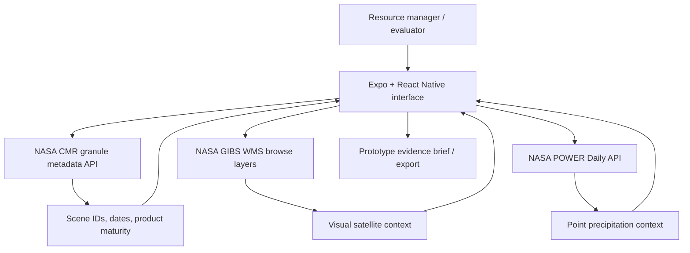
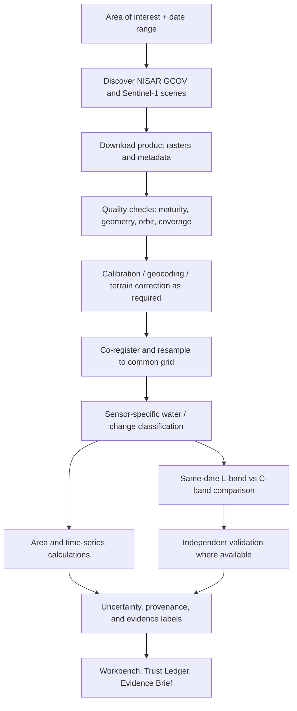

# Architecture

## Current implementation

The current prototype is a client-side Expo app. It does not currently contain a server-side raster-processing pipeline, a persistent project database, authenticated user accounts, or a production community service. Public NASA endpoints are requested by the app; results depend on network access and current endpoint/layer availability.

## Intended scientific processing architecture (not implemented in this repository)

This diagram is the proposed next engineering stage, not a description of functionality already delivered. The scientific pipeline must be reproducible, deterministic, tested on known examples, and explicit about thresholds, resolution, uncertainty, and no-data conditions.

## Frontend modules currently present

- React Native screens and reusable cards, typography, bilingual strings (English and Bangla), controls, map panels, swipe comparison, charts, and PDF/share export.
- Expo SDK 54 and React Native 0.81 dependencies.
- `react-native-svg` for vector overlays and visualizations; `expo-linear-gradient` and Expo font packages for styling.
- Navigation is implemented in app state (not a remote routing service).

## Backend and storage status

There is no application backend in this repository. Scene catalog requests, browse-image requests, and precipitation requests are made from the client. Community posts, sample advisor knowledge, and most feature state are in local JavaScript data structures. A production version would need a server-side geospatial processing service, object storage for validated outputs, a provenance database, caching, monitoring, and an API that returns versioned analysis products.
